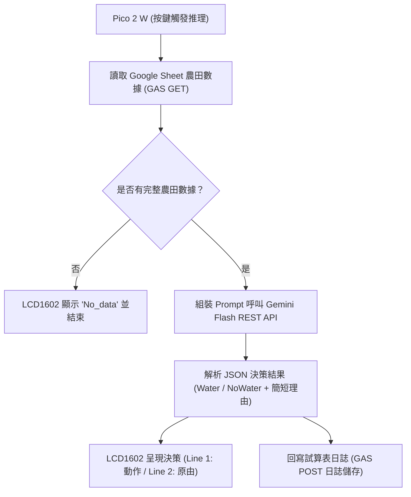

# 系統三：AI 智慧農業灌溉決策系統 開發計劃

本專案為 **Raspberry Pi Pico 2 W + LCD1602** 擴充第三個系統：**「AI 農業灌溉推理決策系統」**。
依據 [`ai農業.md`](file:///D:/練習操作區/創客/mcu_sheet_sync_pico2/ai農業.md) 需求，結合 Google Sheet 試算表農田數據與 Google Gemini 2.5 Flash 雲端模型，進行邊緣環境下的智慧灌溉判斷。

---

## 1. 系統架構與資料流

---

## 2. 核心功能規格

### 2.1 感測輸入特徵 (Input Data from Sheet E Column)
由 Google 試算表 **E 欄最新一筆儲存格** 讀取逗號分隔字串：
* **E1 (標題欄定義)**：
  `空氣濕度(%),氣溫(C),土壤乾度(%),土壤EC,降雨預報`
* **E2 (示範乾燥需澆水範例)**：
  `45,32.5,88,1.4,No Rain`
* **E3 (示範潮濕/將下雨不澆水範例)**：
  `85,22.0,30,0.8,Rain Soon`

依序解析 5 大輸入要素：
1. **空氣濕度** (%)
2. **氣溫** (°C)
3. **土壤乾度** (%)
4. **土壤電解質** (EC 值)
5. **降雨預報** (例如：No Rain / Rain Soon)

### 2.2 前置判斷邏輯
* 呼叫 Google Apps Script 獲取數據。
* **資料檢查**：若農田欄位為空或缺少數值，程式不呼叫 AI，直接於 LCD 螢幕第二行打印：`No_data`。

### 2.3 Gemini Flash 推理設定
* **模型**：`gemini-2.5-flash`
* **金鑰**：載入 `.env` / `config.py` 中的 `GOOGLE_API_KEY`。
* **輸出格式**：強制要求純 JSON，包含：
  - `water`: 布林值（`true` 或 `false`）
  - `decision`: 字串（`WATER` 或 `NO WATER`）
  - `reason`: 簡短英文（**小於等於 16 個英文字元**，以便在 LCD1602 完整顯示且不換行截斷）

### 2.4 雲端日誌回寫 (Cloud Logging)
* 推理完成後，將當次時間、環境數值、決策結果與原由透過 POST 記錄至 Google 試算表的日誌分頁中。

---

## 3. 模組分工與異動範圍

1. [`config.py`](file:///D:/練習操作區/創客/mcu_sheet_sync_pico2/config.py)：
   - 增加讀取 `.env` 取得 `GOOGLE_API_KEY` 或定義備用常數。
2. [`google_apps_script.js`](file:///D:/練習操作區/創客/mcu_sheet_sync_pico2/google_apps_script.js)：
   - 新增 `get_farm_data` API 供讀取最新農田數據。
   - 新增 `log_ai_decision` API 供回寫日誌。
3. [`main.py`](file:///D:/練習操作區/創客/mcu_sheet_sync_pico2/main.py)：
   - 在 `SYSTEMS` 選單中新增項目 `3.AI Agri`。
   - 實作 `run_sys_ai_agri()` 邏輯、Gemini Flash 輕量化 HTTPS 呼叫與 LCD 顯示控制。
